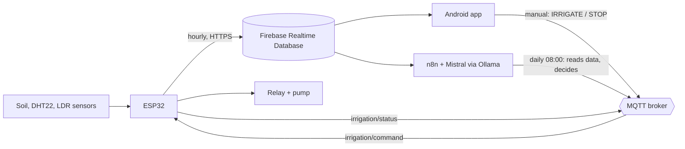

# Smart Irrigation

An ESP32-based irrigation system that reads soil moisture, temperature, humidity and light, waters plants through a relay-driven pump, and can be controlled from a native Android app. A daily n8n workflow asks a local LLM (Mistral via Ollama) whether to irrigate and sends the decision to the device over MQTT.

Built as a university IoT project (ISITCOM, Tunisia), motivated by water scarcity: water only when the data says the soil needs it.

## How it works



- **Telemetry:** the ESP32 sends moisture, temperature, humidity and light to Firebase **once an hour** (HTTP PUT over HTTPS).
- **Commands:** `IRRIGATE` and `STOP` arrive in real time over MQTT on `irrigation/command`. The device replies `DONE` or `STOPPED` on `irrigation/status`.
- **Manual mode:** the Android app publishes the command when you tap the button.
- **Auto mode:** every day at 08:00, n8n reads the latest data from Firebase, asks a local Mistral model to answer `IRRIGATE` or `SKIP`, and publishes the answer.

## Repository layout

| Path | What it contains |
|---|---|
| `firmware/` | ESP32 firmware (Arduino, C/C++) and `secrets.example.h` |
| `mobile-app/` | Native Android app (Java, Firebase + Eclipse Paho MQTT) |
| `automation/` | Exported n8n workflow |
| `docs/` | Project summary and images |

## Hardware

| Component | Notes |
|---|---|
| ESP32 DevKit v1 | 38 pins, USB-C |
| Capacitive soil moisture sensor v1.2 | Analog output, powered at 3.3 V |
| DHT22 | Temperature and humidity |
| LDR (photoresistor) + 10 kΩ resistor | Voltage divider on a breadboard |
| 2-channel relay module | 5 V, opto-isolated, **active LOW** |
| Mini submersible pump | 3 to 6 V DC |

### Wiring

| ESP32 pin | Connected to | Signal |
|---|---|---|
| GPIO 34 | Soil sensor AOUT | Analog input |
| GPIO 4 | DHT22 DATA | Digital |
| GPIO 35 | LDR divider junction | Analog input |
| GPIO 26 | Relay IN1 | Digital output, active LOW |
| 3V3 | Soil sensor VCC, DHT22 VCC, LDR divider | 3.3 V |
| VIN | Relay VCC / JD-VCC | 5 V |
| GND | All grounds, pump negative wire | Common ground |

Rules that matter:
- Soil sensor on **3.3 V only**; relay on **5 V (VIN) only**.
- The relay is active LOW, so the firmware sets GPIO 26 HIGH at boot to keep the pump off.
- Use a 2.4 GHz Wi-Fi network (the ESP32 does not support 5 GHz).

### Soil calibration
Raw ADC readings are mapped to a percentage with two measured points: `SOIL_DRY = 2615` (sensor in air) and `SOIL_WET = 926` (tip in water). Recalibrate for your own sensor.

## Setup

### 1. Firebase
1. Create a project and a **Realtime Database**.
2. Register an Android app with package name `com.example.smartirigation` and download `google-services.json`.
3. Set database rules so that only authenticated users can read and write (see [Known limitations](#known-limitations)).

### 2. Firmware
1. Install the Arduino libraries: **DHT sensor library** (Adafruit), **Adafruit Unified Sensor**, **PubSubClient**. The ESP32 board package provides Wi-Fi and HTTP.
2. Copy `firmware/secrets.example.h` to `firmware/secrets.h` and fill in your Wi-Fi name, password, database URL and API key. This file is git-ignored.
3. Select **ESP32 Dev Module**, then build and upload `firmware/smart_irrigation.ino`.

### 3. Android app
1. Copy your `google-services.json` to `mobile-app/app/` (git-ignored; see `google-services.json.example`).
2. Open `mobile-app/` in Android Studio and run on a device (minSdk 23).

### 4. n8n workflow (auto mode)
1. Install and start [n8n](https://n8n.io), and run [Ollama](https://ollama.com) with the `mistral` model (`ollama pull mistral`, `ollama serve`).
2. Import `automation/smart-irrigation-workflow.json`.
3. Replace the Firebase URL placeholder and set up your MQTT credentials in n8n.

Test the MQTT path without the app:
```bash
mosquitto_pub -h broker.hivemq.com -t irrigation/command -m "IRRIGATE"
```
(Use your own unique topic names if you run this on a public broker.)

## Known limitations

I know the weak spots of this prototype and list them here on purpose.

- **Public MQTT broker without authentication or TLS.** Anyone who knows the topic can publish `IRRIGATE`. A production version needs a private broker with credentials and TLS.
- **Certificate validation is disabled** in the firmware (`setInsecure()`), so HTTPS traffic to Firebase is encrypted but the server is not verified.
- **Firebase rules were left open** during development. Restrict them to authenticated users before using real data.
- **The pump runs inside the MQTT callback** for a fixed 30 seconds. There is no local fallback if Wi-Fi or the broker is down, and no moisture-threshold rule on the device.
- **Telemetry is hourly**, not continuous. Only commands are real time.

## Roadmap
- Local on-device moisture threshold as a fallback, with a maximum watering time
- Authenticated MQTT with TLS and a private broker
- Authenticated Firebase access and certificate pinning
- Weather API check (skip watering if rain is expected)
- OLED status display (I2C is already reserved on GPIO 21 and 22)
- Multiple soil sensors for multi-zone irrigation
- Solar panel and battery for off-grid use

## Author
Youssef Gaied, Computer Engineering licence student (Embedded Systems & IoT).

## License
MIT, see [LICENSE](LICENSE).
